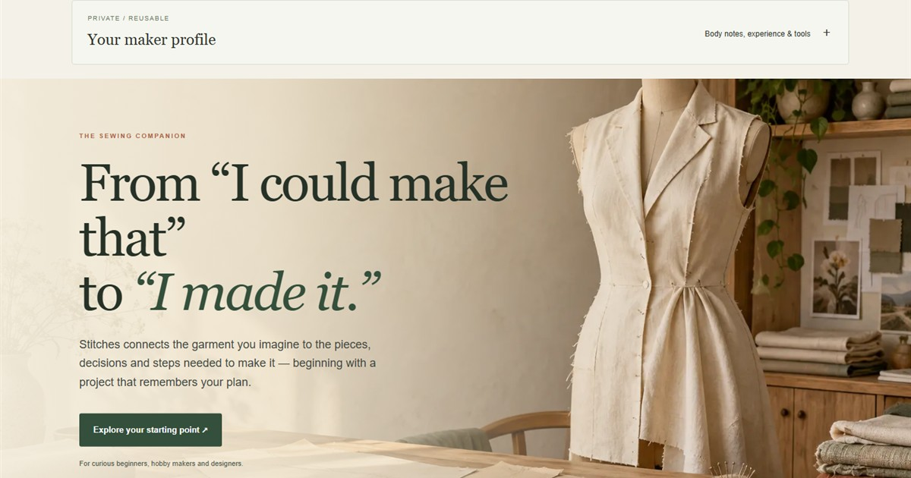
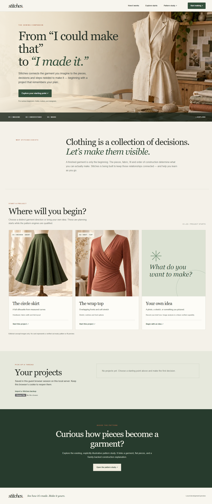
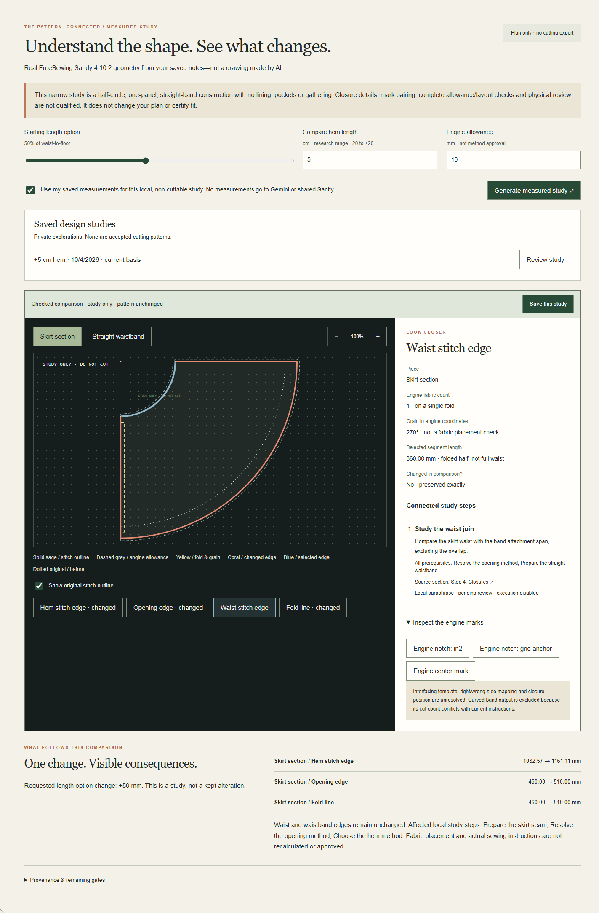
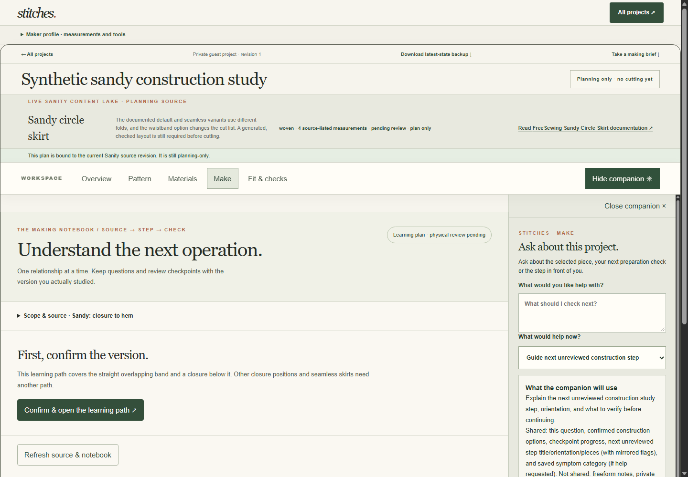
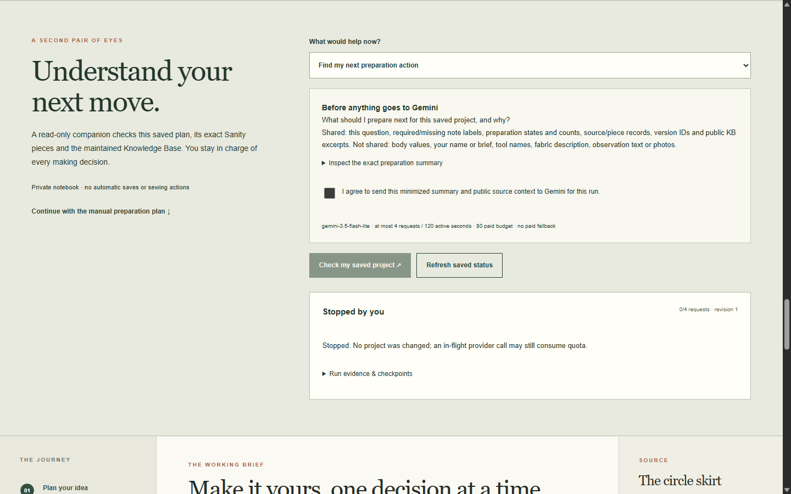

# Stitches



**A sewing project workspace that connects garment ideas to pieces, decisions, and the next making step.** Stitches combines source-linked garment records in Sanity with a bounded Gemini companion, while keeping a maker’s measurements, notes, and project history private to their local guest workspace.

> This is an active research prototype, not a cut-ready pattern service. The two starting projects and their instructions are pending expert review. Stitches does not certify fit, fabric layout, printing, or physical sewing.

## Try the workspace

You can explore the application locally without credentials in fixture mode. The landing page offers three distinct starts: a circle skirt, a wrap top, or a private brief for your own idea. The circle skirt and wrap top are different garment plans—not color variants. Editorial photos are inspiration only and do not change when a project changes.

1. Install the pinned dependencies and build the production app:

   ```powershell
   corepack pnpm install --frozen-lockfile
   corepack pnpm run build
   corepack pnpm run start
   ```

2. Open the local URL printed by Next.js (normally `http://localhost:3000`).
3. Choose **Start making** or a garment card. Follow the project workspaces: **Overview** for your brief and saved choices, **Pattern** for a measured study where available, **Materials** for known requirements and unknowns, **Make** for the selected learning sequence, and **Check** for supported scrap-only troubleshooting.
4. Use **Pattern study** to inspect the Sandy skirt’s measured, before/after geometry comparison. It is a private design study, not a kept alteration or printable cutting pattern.
5. Open the companion beside a selected piece or current step. Review the minimized-data preview and give explicit consent before any Gemini request. The companion can explain source-backed records; its prose is not a maker-approved instruction. No project mutation or sewing action is delegated to the model.

Projects and maker notes are guest-private and stored locally by the single-server prototype. Keep the same browser profile and local server to reopen them. Use the in-app backup before changing machines or clearing browser data. This local SQLite-backed guest store is not configured as a public, multi-instance deployment database.

### Live Sanity and Gemini mode (optional)

Fixture mode is the credential-free way to explore. To test actual integrations, copy `.env.example` to the ignored `.env.local`, then configure the dedicated Stitches **development** Sanity project’s read-only Content Lake and Context credentials, plus a Gemini API key. Keep every secret server-side; never paste credentials into this repository, screenshots, or chat. `scripts/check-local-env.mjs` reports missing variable names and syntax without printing values. Live mode requires the owner-authorized zero-cost Gemini gate; it is disabled by default for other users.

The Sanity project is `l4eeamth`, dataset `development`; the scoped Context Knowledge Base is `kbkvu1vrPsLG` (`stitches-garments`). Do not replace these with another project or dataset. The production dataset is not part of this prototype workflow.

## What makes the companion useful

- **Content is operational, not just searchable.** Sanity’s typed candidate, piece, material, construction-step, and diagnostic records provide applicability, fold/cut flags, options, prerequisites, and source identity. Fixed application tools validate that graph before the model can explain it.
- **The maintained Knowledge Base grounds explanations.** The agent reads the Stitches-scoped Context MCP outline and relevant entry. Missing or stale source evidence blocks that path instead of silently falling back to model memory.
- **The selected object matters.** A piece question is bound to the exact garment, piece, source fingerprint, saved project basis, and retrieved knowledge. Making guidance is similarly tied to the current step and confirmed options.
- **Private project state stays separate.** Measurements, free-text notes, studies, and history are local guest records, not shared Sanity content. Inference requires an explicit minimized-data preview and consent.
- **Failures are visible.** Stale source/project state, missing knowledge, quota, cancellation, and recovery are modeled as distinct outcomes; manual planning remains available when inference is off.

## Screens from the working application

The images below are captures from the local application, not concept mockups. They show separate product surfaces and real prototype limits.

| The project starts | Measured pattern study (Sandy) |
| --- | --- |
|  |  |

| Step-focused making workspace | Companion beside the selected project |
| --- | --- |
|  |  |

More desktop and phone captures, including observed failure and recovery states, are in [`evidence/screenshots/`](evidence/screenshots/).

## Local checks

```powershell
corepack pnpm run typecheck
corepack pnpm test
corepack pnpm run build
```

The automated suite is deterministic by default. Live Context/Gemini checks are opt-in and consume free-tier quota; they are not required for fixture-mode browsing. Current test receipts, live-read checks, build notes, and known gaps are recorded in [`docs/STATUS.md`](docs/STATUS.md) and [`BUILD_LOG.md`](BUILD_LOG.md).

## Current limits and roadmap

This release candidate demonstrates a real project-aware agent loop, actual Stitches Content Lake and Context retrieval, private source-bound project history, source-specific piece learning, a Sandy measured study, construction sequence planning, and test-first scrap diagnostics. A live selected-piece Gemini run is recorded in the evidence folder. These are software and integration results—not a claim that a novice has safely sewn a garment from Stitches.

Still open: independent review and licensing/output-rights checks for the source patterns, complete generator-to-layout parity, validated fit/variation, fabric nesting, tiled print calibration, full-resolution garment-image analysis, wider member testing, a fair scored benchmark, physical maker trials, and production-grade shared persistence/deployment. Stitches does not yet provide user accounts, public hosting, or cut-ready output. See [`docs/PRODUCT-RELEASE-PLAN.md`](docs/PRODUCT-RELEASE-PLAN.md) and [`docs/STATUS.md`](docs/STATUS.md) for the sequenced release gates.

## Project and challenge

Stitches is being prepared for the [Sanity Challenge — Path One: Ship an Agent That Queries Real Content](https://dev.to/challenges/sanity-2026-09-16). The Sanity project ID is `l4eeamth`. The Context Knowledge Base and development dataset contain prototype/editorial material; neither is a public dataset endpoint. No API token or write credential belongs in a public README.

Code: [github.com/Mystic-esque/Stitches](https://github.com/Mystic-esque/Stitches). The repository URL was supplied for this release. Stitches has not been deployed or submitted; public hosting remains a separate release action.

## Product and implementation notes

- [Product direction](docs/PRODUCT.md) · [Design](docs/DESIGN.md) · [Architecture](docs/ARCHITECTURE.md) · [Sanity content model](docs/CONTENT-MODEL.md)
- [Release plan](docs/PRODUCT-RELEASE-PLAN.md) · [Current status](docs/STATUS.md) · [Runbook](docs/AGENT-RUNBOOK.md)
- The `/demo` route is a historical illustrative study. It is not the primary project workspace.
